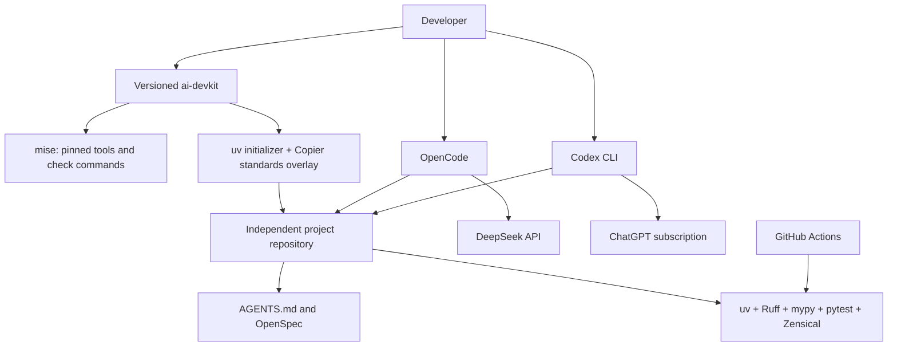

# ai-devkit v0.1 — Minimal Architecture and Implementation Plan

## 1. Executive recommendation

Build **a versioned collection of configurations, engineering rules, documentation and a small Copier overlay**. Keep development execution inside existing tools.

Use:

- **mise** for tool versions and local verification commands.
- **uv** for Python environments, dependencies and lockfiles.
- **uv’s application initializer** for the first Python script scaffold.
- **Copier** for the reusable standards overlay and its updates.
- **OpenSpec** as the sole specification and change-checklist system.
- **OpenCode + DeepSeek** for routine implementation.
- **Codex CLI + ChatGPT sign-in** for planning, difficult problems and review.
- **AGENTS.md**, **Diátaxis**, **Zensical** and **GitHub Actions** for shared standards and verification.

Start with one profile: **an unpackaged Python application/script**, containing a runnable entry point, a smoke test, linting, type checking and documentation.

Do not adopt an entire existing Python template merely to remove most of its features. The inspected templates introduce packaging, release automation or additional command layers. Reuse `uv init` for that small scaffold and maintain only the devkit-specific overlay.

Defer Cezar. Its documentation describes useful persistence and workflow capabilities, but also experimental OpenCode support and permission behavior unsuitable as an assumed security boundary.

The MVP should prove one complete journey: install pinned tools on Linux, authenticate agents through their native mechanisms, create a project, specify a change, implement it and pass the same checks locally and in CI.

**Research status:** documentation and repository inspection completed on 5 November 2026. No installation, implementation, credential access or paid inference was performed. Runtime compatibility remains an explicit implementation acceptance gate.

## 2. Reuse matrix

“Configure—deferred” means a possible later adoption, with no v0.1 implementation.

| Requirement | Existing solution | Decision | Justification | Compatibility or maintenance risk |
|---|---|---|---|---|
| Tool versions | mise | **Configure** | One tool manifest and native task runner. | Pin mise itself; lock coverage depends on backend. |
| Python dependencies | uv | **Configure** | Native environments, dependency editing and `uv.lock`. | Prevent competing Python installation ownership. |
| Initial Python scaffold | `uv init --app --no-package` | **Reuse** | Maintained initializer already supports scripts and applications. | Initializer defaults can change; specify flags explicitly. |
| Reusable standards and updates | Copier | **Configure** | Render a small overlay; retain its answers and update lineage. | Updates can conflict with project edits. |
| Existing Python templates | `pawamoy/copier-uv`, `jlevy/simple-modern-uv` | **Reuse—deferred** | Reconsider for the library profile; unnecessary packaging and maintenance tooling for the first script. | Upstream conventions and dependency choices become additional commitments. |
| Specifications and implementation checklist | OpenSpec | **Configure** | Existing Markdown workflow and supported agent integrations. | Generated integration paths and commands evolve. |
| Routine coding | OpenCode + direct DeepSeek API | **Configure** | Official provider integration; no gateway needed. | Model aliases and harness support can drift. |
| Advanced coding | Codex CLI + ChatGPT authentication | **Configure** | Official subscription authentication. | Account eligibility, available models and usage limits vary. |
| Backlog execution in Cline | Cline + DeepSeek | **Configure** | Use as the implementation agent requested for this backlog. | Current model availability must be checked in the installed version. |
| Shared engineering instructions | AGENTS.md | **Configure** | Common entry point supported by the initial agents. | Instruction discovery differs between harnesses and versions. |
| Engineering skills | OpenSpec-generated skills; Superpowers and Trail of Bits libraries | **Reuse selectively** | Use OpenSpec’s own workflow skills; defer additional library installation. | Broad libraries may duplicate OpenSpec or impose conflicting process; licensing differs. |
| Documentation architecture | Diátaxis | **Reuse** | Clear separation of learning, procedures, reference and explanation. | Content quality still requires human review. |
| Documentation generation | Zensical | **Configure** | Markdown source, native strict build and internal-link validation. | Evolving compatibility; avoid assuming arbitrary MkDocs plugins work. |
| Automated verification | Ruff, mypy, pytest | **Configure** | One formatter/linter, one type checker, one test runner. | Check rendered projects, not just template source. |
| CI | GitHub Actions | **Configure** | Invoke the same verification commands used locally. | Pin actions and avoid privileged PR execution. |
| Autonomous orchestration | Cezar | **Configure—deferred** | Existing workflows, persistence and worktrees address the future need. | OpenCode backend is experimental; documented permission defaults need evaluation. |
| Devkit-specific policy and examples | Short rules, ADRs, overlay and integration tests | **Build** | These express this product’s choices rather than replace maintained functionality. | Keep the maintained surface small. |

Supporting documentation: [mise lockfiles](https://mise.jdx.dev/dev-tools/mise-lock.html), [uv initialization](https://docs.astral.sh/uv/reference/cli/#uv-init), [Copier updates](https://copier.readthedocs.io/en/stable/updating/), [Copier UV](https://github.com/pawamoy/copier-uv), [simple-modern-uv](https://github.com/jlevy/simple-modern-uv), [OpenSpec integrations](https://openspec.dev/docs/supported-tools).

**Reference repository audit.** Reviewed commit `d035235c09cf057665cdc526acffa231724b9614`, including its architecture, ownership rules, execution policy and tool inventory.

Retain its emphasis on small working slices, executable checks, explicit ownership, selective context loading and reviewed template updates. Replace its custom execution-policy resolver and context router with native agent configuration and concise instructions. Replace its managed project lifecycle with OpenSpec’s change artifacts. Leave behind task-state YAML, boards, claims, handoff tooling, dashboards, release scripts and the multi-axis profile matrix. These are substantial implementations in the reference, not requirements for the new project. [Reference architecture](https://github.com/Semtexcz/_ai_project_template/blob/d035235c09cf057665cdc526acffa231724b9614/docs/template-architecture.md)

**Do not implement:** an agent dispatcher, model router, package manager, LLM gateway, workflow engine, task database, dashboard, credential manager, custom documentation-link checker or external-skill synchronization framework.

## 3. Proposed minimal architecture and Mermaid diagram

### Responsibilities and ownership

| Concern | Authoritative owner | Integration boundary |
|---|---|---|
| Runtime and CLI versions | Each repository’s mise configuration and lockfiles | Native executables |
| Python dependencies | Each project’s `pyproject.toml` and `uv.lock` | Native uv commands |
| Overlay provenance | Copier answers file | Native `copier update` |
| Engineering rules | Root AGENTS.md | Links to focused documentation |
| Required behavior and change checklist | OpenSpec artifacts | Native CLI and generated agent skills |
| Application behavior | Project source and tests | Ordinary Python |
| Agent model, permissions and authentication | Native agent configuration and credential storage | No shared adapter API |
| Verification commands | mise tasks | Direct calls to maintained checkers |
| Product documentation | Project Markdown | Zensical builds HTML |
| CI execution | GitHub Actions | Calls mise tasks |
| Orchestration | None in v0.1 | Future optional tool must invoke existing boundaries |



### Keep the six concepts separate

- **Harness:** OpenCode, Codex CLI or another supported coding application.
- **Provider:** DeepSeek, OpenAI or a compatible local endpoint.
- **Model:** a provider-specific identifier selected through that harness.
- **Execution profile:** native settings for model, reasoning and permissions.
- **Role:** the responsibility in the current task—planner, implementer or reviewer.
- **Orchestrator:** an optional process coordinating runs; absent from v0.1.

There will be **no common role-to-model configuration schema**. Recommended assignments live in documentation; actual selections use native settings and task prompts.

Initial defaults:

| Work | Harness/provider | Model selection |
|---|---|---|
| Routine implementation and repair | OpenCode/DeepSeek | `deepseek-flash`, subject to the pinned harness exposing it |
| Planning, difficult debugging and review | Codex/OpenAI | Account-supported Codex default; explicitly overridable |
| Implementing this backlog | Cline/DeepSeek | Current compatible Flash model through native provider settings |

These are defaults, not capabilities hardcoded into the project.

### Initialization and updates

Use a documented sequence of native commands, without creating a devkit CLI:

1. Install a pinned mise release into the user account.
2. Clone a tagged devkit release; review/trust its mise configuration.
3. Install locked tools and synchronize the devkit’s locked Python dependencies.
4. Run `uv init --app --no-package --no-workspace --no-pin-python --no-readme --vcs none` into a new destination.
5. Apply the tagged Copier overlay.
6. Add the release’s exact baseline development dependencies through `uv add`; commit the resulting project lockfile.
7. Initialize OpenSpec, run verification and initialize the project’s own Git history.

The overlay owns standards, verification configuration and documentation seeds. It **does not render or update application code, `pyproject.toml` or `uv.lock`**. Python dependencies remain native uv-managed project configuration.

Use semantic version tags for devkit releases. Update tools and dependencies through reviewed changes, followed by generation and update tests. Copier updates require a clean project and an explicit target release. OpenSpec owns regeneration of its integration files.

### Documentation and credentials

Use `docs/tutorials`, `docs/how-to`, `docs/reference` and `docs/explanation`; place short ADRs under explanation. Product documentation and ADRs belong to the generated project. Shared instructions and workflow documentation are merge-sensitive overlay content.

Keep DeepSeek keys and Codex authentication in native user-level storage or externally supplied environment variables. Never copy subscription tokens between harnesses. Do not overwrite existing user configuration automatically. Git ignore rules prevent accidental tracking but are **not** an agent access-control mechanism.

## 4. Key technical decisions and tradeoffs

### Supported by current documentation

**mise and uv have separate ownership.** mise installs Python, Node and CLIs; uv manages Python environments and project dependencies. Disable uv-managed Python selection for this workflow and execute uv under mise. Commit `mise.lock`, any generated sidecars, and `uv.lock`; tool locks do not replace application locks. [mise locking](https://mise.jdx.dev/dev-tools/mise-lock.html), [uv projects](https://docs.astral.sh/uv/guides/projects/)

**Explicitly request an unpackaged application.** Current uv documentation says applications are packaged by default. `--no-package`, `--no-workspace` and `--no-pin-python` prevent unwanted packaging, parent-workspace membership and a second Python-version file. [uv CLI](https://docs.astral.sh/uv/reference/cli/#uv-init)

**Use OpenSpec without a second planning system.** Its CLI initializes integrations for OpenCode, Codex and Cline. Let OpenSpec generate those files; do not maintain copied versions in the overlay. Specification validation checks structure, not implementation correctness. [Supported tools](https://openspec.dev/docs/supported-tools), [CLI reference](https://openspec.dev/docs/cli)

**Use direct DeepSeek access.** DeepSeek documents OpenCode integration and currently recommends OpenCode ≥1.18.30. Its API currently names the economical model `deepseek-flash`; older Flash names may resolve to replacement models. Pin the tested harness and make model selection editable. [OpenCode integration](https://api-docs.deepseek.com/quick_start/agent_integrations/opencode/), [DeepSeek models](https://api-docs.deepseek.com/quick_start/pricing/)

**Use Codex’s official ChatGPT sign-in.** Subscription access and API-key access are different authentication and billing paths. Store optional configuration profiles at the documented user-level location; current documentation says project-local configuration cannot override several provider and profile settings. [Authentication](https://learn.chatgpt.com/docs/auth), [Configuration reference](https://learn.chatgpt.com/docs/config-file/config-reference)

**Keep instructions portable.** OpenCode and Cline document AGENTS.md support. Cline’s rule must be enabled in its Rules interface; no duplicated `.clinerules` engineering policy is necessary. [OpenCode rules](https://opencode.ai/docs/rules/), [Cline rules](https://docs.cline.bot/customization/cline-rules)

**Adopt Zensical with built-in features only.** Its documented strict build validates internal links and anchors. Keep Markdown portable and avoid an API-documentation plugin dependency in the script profile. Use FastAPI’s runnable examples and progressive explanations as the editorial benchmark. [Zensical validation](https://zensical.org/docs/setup/validation/), [Diátaxis](https://diataxis.fr/), [FastAPI documentation](https://fastapi.tiangolo.com/)

**Do not install a broad skill framework.** Superpowers provides a wider development methodology that would overlap the selected workflow. Trail of Bits offers relevant individual skills, including modern Python, but its current library license requires consideration before redistribution. OpenSpec-generated skills plus short engineering rules suffice initially. [Superpowers](https://github.com/obra/superpowers), [Trail of Bits skills](https://github.com/trailofbits/skills)

**Defer Cezar on concrete compatibility grounds.** Its reference documents persistent workflows and human gates, but marks OpenCode experimental and says it auto-approves permissions. Its Codex backend documents permissive default execution settings. Future evaluation must test these boundaries and restart recovery explicitly. [Cezar reference](https://github.com/open-mercato/cezar/blob/main/docs/reference.md)

### Assumptions requiring practical validation

- Python **3.13** and Node **24** are conservative initial runtime lines; exact patches and CLI releases will be frozen as a tested tuple in Task 2.
- OpenCode’s pinned release exposes the current DeepSeek model and correctly handles its tool calls.
- Cline’s installed release supports the chosen DeepSeek model; use its documented compatible-provider configuration if necessary, without custom integration code. [DeepSeek’s Cline guidance](https://github.com/deepseek-ai/awesome-deepseek-agent/blob/main/docs/cline.md)
- Copier updates preserve project-owned documentation and report conflicting shared-rule edits.
- Zensical’s selected release fails the intended negative link tests.
- AGENTS.md and OpenSpec guidance are actually discovered by both initial harnesses.

### Cost policy

Use DeepSeek for bounded implementation. After two unsuccessful repair attempts, stop and hand the failure evidence to a human or stronger model; this is a documented operating rule, not an automatic retry engine.

DeepSeek API usage is metered. Codex subscription usage has account-dependent limits. Do not present subscription use as unlimited, convert it into invented dollar costs, or silently fall back to paid API authentication.

## 5. MVP scope and deferred features

**v0.1 acceptance journey**

On a fresh Ubuntu 24.04 x86-64 user account, with Git, download utilities and CA certificates available:

1. Install the pinned toolchain without routine administrator privileges.
2. Configure OpenCode/DeepSeek and Codex/ChatGPT through their native authentication.
3. Create an independent Python script project using the documented recipe.
4. Run its initial program and smoke test.
5. Propose and implement one small behavior change through OpenSpec.
6. Pass `mise run check` locally and in GitHub Actions.
7. Demonstrate an overlay update without losing a project-owned edit.

**Verification contract**

The generated project’s `mise run check` runs:

```text
uv lock --check
uv run --locked ruff check .
uv run --locked ruff format --check .
uv run --locked mypy --strict main.py
uv run --locked pytest
uv run --locked zensical build --strict
openspec validate --all --strict --no-interactive
```

Expand the type-checking target when application modules are added. Verification may create ignored caches and documentation output; it must not rewrite tracked sources.

**Shared Definition of Done:** scoped behavior works; relevant tests and static checks pass; documentation and specifications reflect the result; significant decisions have an ADR; the diff contains no credentials, unrelated changes or unresolved conflicts; verification evidence and limitations are reported.

**Deferred:** additional profiles, package publishing, containers, native Windows support, guaranteed macOS/WSL2 support, local-model certification, Cline/Claude Code installation automation, extra skill packages, automatic model escalation, remote services, orchestration, dashboards, bots and custom cost accounting.

macOS and WSL2 receive practical setup notes; Linux remains the release acceptance platform.

## 6. Dependency-ordered implementation backlog

Each task is one independently reviewable commit-sized change. All use the shared Definition of Done above. **Cline + economical DeepSeek is the default implementation class for every task**; Codex review is optional where identified.

### Task 1 — Establish the repository contract

- **Goal:** make the empty repository understandable and safe for subsequent agents.
- **Scope/files:** README.md, AGENTS.md, `.gitignore`, and one architecture ADR.
- **Non-goals:** executable tooling, templates, installations, CI, agent configuration or copied external skills.
- **Inputs:** the self-contained prompt in section 7.
- **Acceptance:** clearly distinguish intended v0.1 behavior from currently implemented functionality; define minimal engineering rules and boundaries.
- **Verification:** `git diff --check`; inspect new-file whitespace, local links and ignore behavior using the commands in section 7.
- **Dependencies:** none.
- **Agent/model:** Cline + economical DeepSeek.
- **Documentation:** all task output is repository documentation or hygiene configuration.
- **DoD addition:** only the four allowed files change; no commands are advertised as already working.

### Task 2 — Pin the toolchain and enable documentation verification

- **Goal:** establish a reproducible maintainer environment.
- **Scope/files:** mise configuration/locks, root `pyproject.toml`/`uv.lock`, Zensical configuration and minimal Diátaxis pages.
- **Non-goals:** project generation, authentication or model calls.
- **Inputs:** Task 1; official installation and configuration documentation.
- **Acceptance:** freeze exact releases of mise, Python 3.13, Node 24, uv, OpenSpec, OpenCode and Codex. Use native mise backends; lock generated sidecars. Lock Copier, pytest, Ruff, mypy and Zensical as Python development tooling.
- **Verification:** `mise install --locked`; `mise exec -- uv sync --locked`; each CLI’s `--version`; `mise run docs`.
- **Dependencies:** Task 1.
- **Agent/model:** Cline + economical DeepSeek; escalate only an evidenced installation incompatibility.
- **Documentation:** user-local installation guide, version ownership reference and tested-version table.
- **DoD addition:** record the tested tuple; no floating versions or global configuration overwrite. The initial `check` task may contain only checks applicable at this stage.

### Task 3 — Document and configure native agent profiles

- **Goal:** make economical and advanced execution selectable without a routing layer.
- **Scope/files:** credential-free native configuration examples and agent setup/selection documentation.
- **Non-goals:** universal launchers, credential copying, automatic authentication or paid smoke tests.
- **Inputs:** Task 2’s pinned CLIs.
- **Acceptance:** OpenCode example selects DeepSeek explicitly, including auxiliary model settings that could otherwise introduce unexpected providers. Codex instructions use ChatGPT login and documented user-level profiles. Explain role assignment and model overrides. Include optional Cline setup.
- **Verification:** CLI `--help`/`--version`; parse example JSON/TOML with standard libraries. Inspect effective configuration only in an isolated, credential-free test home.
- **Dependencies:** Task 2.
- **Agent/model:** Cline + economical DeepSeek.
- **Documentation:** setup, credential locations, billing distinctions, model selection and repair/escalation procedure.
- **DoD addition:** separate syntactic verification from still-unverified authenticated operation.

### Task 4 — Deliver the Python script overlay

- **Goal:** create the first runnable project through maintained generators.
- **Scope/files:** Copier configuration, small overlay, project smoke test and generation integration test.
- **Non-goals:** alternate profiles, packaged applications, custom generation CLI or Copier hooks executing setup commands.
- **Inputs:** Tasks 1–2; explicit native uv initialization flags.
- **Acceptance:** document the complete creation recipe with exact baseline dependency versions. Render rules, check tasks, standalone checker configuration, documentation seeds and ignore rules. Never render application code or Python dependency manifests. Store Copier provenance.
- **Verification:** `mise run test-template`; in the generated fixture, `uv run --locked python main.py` and `mise run check`.
- **Dependencies:** Task 2; Task 3 is not required.
- **Agent/model:** Cline + economical DeepSeek.
- **Documentation:** first-project tutorial, command reference and file-ownership explanation.
- **DoD addition:** test a destination containing spaces, independent project creation and successful initial verification. Until Task 5, omit the OpenSpec check.

### Task 5 — Add the OpenSpec vertical slice

- **Goal:** demonstrate specification, implementation and verification in one project.
- **Scope/files:** native OpenSpec initialization, its generated integrations, one real devkit specification and a worked tutorial.
- **Non-goals:** custom schemas, task metadata, alternate spec systems or copied integration templates.
- **Inputs:** Tasks 3–4.
- **Acceptance:** use `openspec init --tools opencode,codex --profile core`; document optional Cline initialization. Add specification validation to `check`. Demonstrate a small script change with a regression test and documentation update.
- **Verification:** `openspec validate --all --strict --no-interactive`; `mise run test-template`; `mise run check`.
- **Dependencies:** Tasks 3–4.
- **Agent/model:** Cline + economical DeepSeek for bounded artifacts; optional Codex review of requirement quality.
- **Documentation:** propose → review → implement → verify → archive tutorial, using each harness’s actual command syntax.
- **DoD addition:** OpenSpec remains the sole implementation checklist; generated integrations have one owner.

### Task 6 — Prove CI and update behavior

- **Goal:** catch integration failures before a devkit release.
- **Scope/files:** GitHub Actions and lifecycle integration tests.
- **Non-goals:** deployments, publishing, model-powered CI or release automation.
- **Inputs:** Tasks 4–5.
- **Acceptance:** CI uses pinned actions, read-only repository permissions and the same mise tasks as local development. Test Copier updates between temporary tagged fixture revisions.
- **Verification:** `mise run check`; `mise run test-template`.
- **Required scenarios:** edited application survives update; project documentation survives; shared-rule conflicts remain visible; formatting, typing, failing tests, broken documentation links and invalid specifications each cause a nonzero result.
- **Dependencies:** Task 5.
- **Agent/model:** Cline + economical DeepSeek; optional Codex review of ownership and CI permissions.
- **Documentation:** CI troubleshooting and reviewed update procedure.
- **DoD addition:** no credentials or inference in CI; successful verification leaves tracked files unchanged.

### Task 7 — Validate the clean-machine journey

- **Goal:** establish evidence that v0.1 delivers its promised outcome.
- **Scope/files:** final tutorial corrections, compatibility evidence and release notes.
- **Non-goals:** new features, broader platform claims or unattended orchestration.
- **Inputs:** Task 6; disposable Linux workstation/VM and user-controlled agent accounts.
- **Acceptance:** complete the documented journey without undeclared tools or absolute machine paths. Separately perform one user-authorized live task with each initial harness.
- **Verification:** `mise install --locked`; locked dependency synchronization; project creation recipe; generated `mise run check`; green CI; `git diff --exit-code` after verification.
- **Dependencies:** Task 6.
- **Agent/model:** Cline + economical DeepSeek for fixes; human performs account authentication and authorizes live usage.
- **Documentation:** tested environment, actual commands, limitations and tagged-release instructions.
- **DoD addition:** mark live tests passed or explicitly pending; do not claim end-to-end agent compatibility from `--version` checks.

## 7. Complete implementation prompt for Task 1

```text
You are implementing Task 1 of ai-devkit.

Goal
Establish the repository’s documentation and engineering contract.
The repository is expected to contain no application implementation.
Inspect its current state and applicable instructions before editing.
Preserve unrelated existing work.

Implement exactly these four files:
1. README.md
2. AGENTS.md
3. .gitignore
4. docs/explanation/decisions/0001-minimal-devkit.md

Use English. Keep the total prose below approximately 1,000 words.

README.md
- Describe ai-devkit as a portable, versioned collection of development
  configurations, rules, documentation and a small project overlay.
- State the philosophy: Reuse → Configure → Extend → Build.
- State that this commit establishes documentation only.
- Describe the intended v0.1 stack:
  mise; uv; native uv application initialization; Copier standards overlay;
  OpenSpec; OpenCode with DeepSeek; Codex CLI with ChatGPT sign-in;
  AGENTS.md; Ruff; mypy; pytest; Diátaxis; Zensical; GitHub Actions.
- The first profile is an unpackaged Python application/script.
- State that ai-devkit is independent of _ai_project_template.
- Link to AGENTS.md and the ADR using working relative links.
- Do not add setup commands that are not implemented yet.

AGENTS.md
Define concise, portable rules:
- Reuse maintained solutions before adding custom functionality.
- Keep architecture proportional to the application and responsibilities clear.
- Use existing libraries when appropriate; avoid speculative abstractions.
- Make bounded changes and inspect relevant code before editing.
- Read only context needed for the current task; link to durable documentation
  rather than copying it into multiple instruction files.
- Use one authoritative source for each concern.
- OpenSpec will own specifications and implementation checklists.
- Native agent configuration owns provider, model and execution settings.
- Never hardcode a required agent or provider into application code.
- Documented future verification entry point is “mise run check”;
  explicitly say it is not available in this commit.
- Do not claim verification passed when it was not run.
- Definition of Done: requested behavior works, relevant checks pass,
  documentation/specifications are updated, significant decisions have an ADR,
  and the diff has no credentials, conflicts or unrelated changes.
- Check commands must not rewrite tracked source files.
- Credentials stay outside Git in native user storage or external environment
  variables; never print or copy authentication tokens.
- No custom orchestration engine, task database, dashboard, package manager,
  LLM gateway or universal agent abstraction.
- Follow additional applicable local instructions without copying host-specific
  paths into these portable rules.

ADR
Use these headings:
Title
Status
Context
Decision
Consequences

Title: Minimal configuration-first devkit
Status: Accepted

Record:
- The purpose is delivering software with low infrastructure maintenance.
- mise owns runtime/tool versions and verification task definitions.
- uv owns Python environments and dependency manifests/lockfiles.
- Native uv initialization supplies the first unpackaged Python scaffold.
- Copier supplies an additive standards/documentation overlay.
- The overlay does not own application code, pyproject.toml or uv.lock.
- OpenSpec is the sole specification/change-checklist system.
- Harness, provider, model, execution profile, role and orchestrator are distinct.
- Initial harness/provider combinations are OpenCode/DeepSeek and
  Codex/ChatGPT-authenticated OpenAI access.
- Role and model choices use task prompts and native agent configuration;
  there is no shared routing engine.
- Diátaxis organizes Markdown documentation; Zensical will build it.
- Orchestration and additional project profiles are deferred.
- The tradeoff is a few explicit native setup commands instead of a new CLI.
- These are architectural decisions, not claims of implemented integrations.

.gitignore
Ignore:
.env
.env.*
.venv/
__pycache__/
*.py[cod]
.pytest_cache/
.ruff_cache/
.mypy_cache/
node_modules/
site/

Explicitly allow .env.example.
Do not ignore lockfiles or agent instruction/skill directories.

Non-goals and boundaries
- Do not install or execute project tooling.
- Do not create pyproject.toml, mise configuration, templates, workflows,
  scripts, tests, external skill copies or any other files.
- Do not access credentials or private mail.
- Do not call model APIs.
- Do not modify global configuration.
- Do not stage, commit, push or initialize Git.
- No external research is necessary for this documentation task.

Verification
1. Run:
   git status --short
   git diff --check

2. Run this read-only check, which also covers newly created files:

   python3 - <<'PY'
   from pathlib import Path

   files = [
       Path("README.md"),
       Path("AGENTS.md"),
       Path(".gitignore"),
       Path("docs/explanation/decisions/0001-minimal-devkit.md"),
   ]
   for path in files:
       assert path.is_file(), path
       text = path.read_text(encoding="utf-8")
       assert text.endswith("\n"), path
       assert all(line == line.rstrip() for line in text.splitlines()), path
       assert not any(
           line.startswith(("<<<<<<< ", "=======", ">>>>>>> "))
           for line in text.splitlines()
       ), path

   assert Path("AGENTS.md").exists()
   assert Path("docs/explanation/decisions/0001-minimal-devkit.md").exists()
   print("Documentation file checks passed.")
   PY

3. Check ignore behavior:

   printf '%s\n' \
     .env .env.local .venv/probe \
     .env.example uv.lock mise.lock AGENTS.md |
     git check-ignore --no-index --stdin

   Expected output contains only:
   .env
   .env.local
   .venv/probe

4. Manually check that both README links resolve, the four files are consistent,
   and no unavailable command is presented as working.

If python3 or Git is unavailable, report the unavailable check; do not install it.

Completion report
List changed files, verification results and any limitations.
Stop for review.
```

## 8. Unresolved decisions and major risks

**No architectural question blocks the proposed MVP.** Defaults are intentionally reversible.

| Item | Resolution or remaining gate |
|---|---|
| Exact tool versions | Freeze and test the complete tuple in Task 2; documentation research is not an installation test. |
| DeepSeek alias changes | Record the tested model identity; retain editable native configuration. Model behavior cannot be locked like a package artifact. |
| Subscription eligibility and limits | Confirm during native user authentication; never silently substitute API billing. |
| Cline model-catalog lag | Validate the installed version and documented compatible-provider route before executing coding tasks. |
| Initial dependency resolution | Each generated project commits its own lockfile. Do not promise byte-identical independent generation from an unbounded fresh resolution. |
| Template update conflicts | Require clean Git state, explicit release selection and lifecycle tests; retain human diff review. |
| Agent permissions | AGENTS.md is guidance. Native permissions and OS boundaries govern execution; gitignore does not protect secrets from agents. |
| Cezar adoption | Deferred pending tests of approval handling, process interruption, restart recovery and model-selection ownership. |
| Platform breadth | Ubuntu x86-64 is the acceptance target; macOS and WSL2 remain best effort until tested. |
| Licensing/public distribution | No license is selected by this plan. Decide before public distribution or incorporating redistributed third-party skills. |

The only custom production surface in v0.1 is the small standards overlay and its documentation. Everything else remains configuration of maintained tools.
